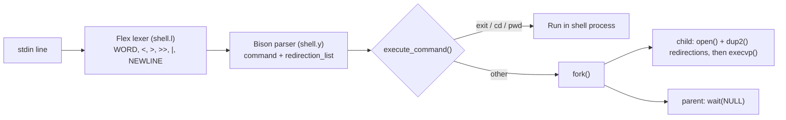
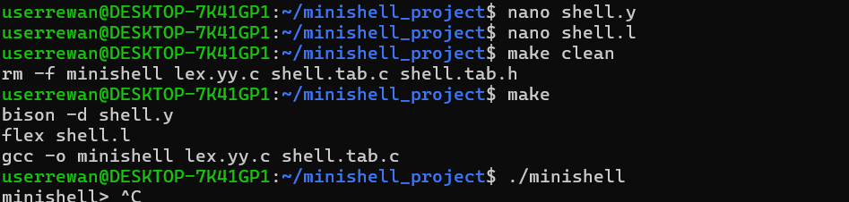

# Flex/Bison Minishell

A minimal Bash-like command interpreter written in C, with a **Flex** lexer and a **Bison** grammar. It shows core operating-system concepts: process creation with `fork()`, program execution with `execvp()`, built-in commands that change the shell's own state, and I/O redirection with `open()` and `dup2()`.

Assignment 3 for Operating Systems (CSE233) at Alamein International University.

## Features

- **Prompt loop:** prints `minishell> ` and reads commands line by line until `exit` or end of input (Ctrl-D).
- **External commands:** the shell forks a child, which calls `execvp(argv[0], argv)` (so `PATH` is searched). The parent waits with `wait(NULL)`.
- **Built-in commands** run in the shell process itself:
  - `cd <dir>`: changes the working directory with `chdir()` and reports failures with `perror("cd failed")`. `cd` with no argument does nothing.
  - `pwd`: prints the current directory with `getcwd()`.
  - `exit`: terminates the shell.
- **I/O redirection** for external commands, set up in the child before `execvp()`:
  - `< file`: stdin from `file` (`O_RDONLY`)
  - `> file`: stdout to `file` (`O_WRONLY | O_CREAT | O_TRUNC`, mode `0644`)
  - `>> file`: stdout appended to `file` (`O_WRONLY | O_CREAT | O_APPEND`, mode `0644`)

## How it works



- **`shell.l` (lexer):**
  - Skips spaces and tabs.
  - Emits `NEWLINE`, `PIPE` (`|`), `REDIRECT_IN` (`<`), `REDIRECT_OUT` (`>`) and `REDIRECT_APPEND` (`>>`).
  - A `WORD` is any run of `[a-zA-Z0-9._/-]`.
  - Every other character is silently discarded.
- **`shell.y` (parser and executor):**
  - A line is either empty or `command redirection_list NEWLINE`.
  - `command` is one or more `WORD`s, collected into a fixed `arg_list[100]`.
  - Each redirection sets the input or output file and the append flag.
  - At the end of a line, `execute_command()` dispatches to a built-in or forks and executes the program.
  - `main()` prints the first prompt and calls `yyparse()`.

## Project structure

```text
.
├── shell.l                    # Flex lexer
├── shell.y                    # Bison grammar, command execution, main()
├── Makefile                   # Builds the minishell executable
├── THEORITYCAL.pdf            # Written answers to the assignment's theory questions
├── ASSS2.png                  # Screenshot: make clean, make, ./minishell
├── ASSSSSSSSS.png             # Screenshot: make clean and make
├── ASSSSSSSSSSSSSSSSSSS.png   # Screenshot: project directory listing after the build
├── LICENSE
└── README.md
```

## Getting started

### Prerequisites

- A Linux/POSIX environment
- `flex`, `bison`, `gcc` and `make`

On Debian or Ubuntu: `sudo apt install flex bison gcc make`.

### Build

```bash
git clone https://github.com/Rewanooo22/flex-bison-minishell.git
cd flex-bison-minishell
make
```

`make` runs these three steps:

```text
bison -d shell.y                          # generates shell.tab.c and shell.tab.h
flex shell.l                              # generates lex.yy.c
gcc -o minishell lex.yy.c shell.tab.c     # links the executable
```

`make clean` removes `minishell`, `lex.yy.c`, `shell.tab.c` and `shell.tab.h`.



### Run

```bash
./minishell
```

Example session:

```text
minishell> pwd
minishell> ls -l > listing.txt
minishell> wc -l < listing.txt
minishell> echo more >> listing.txt
minishell> cd /tmp
minishell> exit
```

## Theory questions

`THEORITYCAL.pdf` answers four questions:

1. The roles of `fork()` and `execvp()` in a shell.
2. How redirection is implemented with `dup2()`.
3. The difference between the lexer and the parser.
4. Why `cd` and `exit` must be built-ins.

## Limitations

- **Pipes are not supported.** The lexer produces a `PIPE` token, but no grammar rule uses it, so a line that contains `|` is a syntax error. The grammar has no `error` recovery rule, so `yyparse()` returns and **the shell exits** on any syntax error. `yyerror()` prints nothing.
- **Limited word characters:** a word may only contain letters, digits, `.`, `_`, `/` and `-`. Quotes, `~`, `$`, `*`, `=` and other characters are dropped by the lexer, so there is no quoting, globbing or variable expansion.
- **Redirection on built-ins:** built-ins ignore redirection, and they return before the redirection state is reset. A redirection given to a built-in (e.g. `pwd > out.txt`) therefore carries over to the next external command.
- **Failed commands:** if `execvp()` fails (e.g. the command is not found), the child exits with status 1 and prints no message. A redirection file that cannot be opened is skipped silently.
- **Other gaps:**
  - no background jobs (`&`)
  - no signal handling
  - no command history
  - no environment-variable handling
  - a fixed limit of 100 arguments with no bounds check

## Future improvements (ideas)

- Add a pipeline rule to the grammar and connect the commands with `pipe()` and `dup2()`.
- Add an `error` production so that a syntax error resets the line instead of ending the shell.
- Apply and reset redirection state for built-ins as well.
- Report `execvp()` failures with `perror()`.

## Author and course

REWAN HANY. Course: Operating Systems (CSE233), Alamein International University.

## License

Released under the [MIT License](LICENSE).
